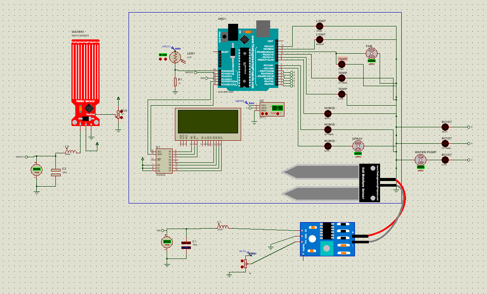
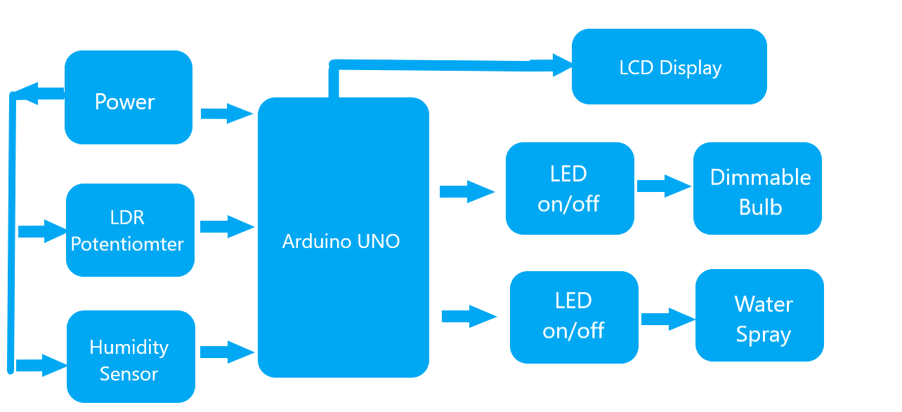
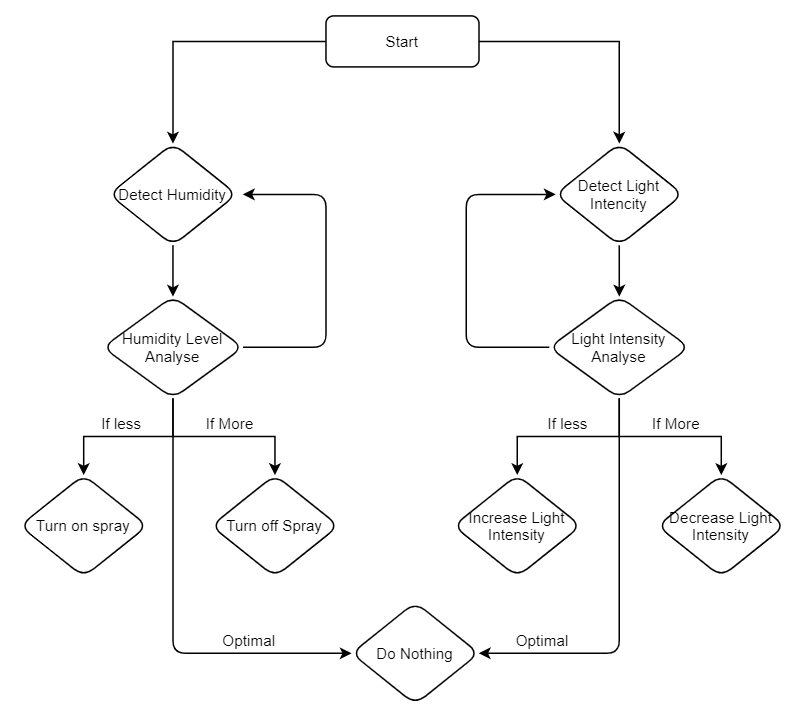
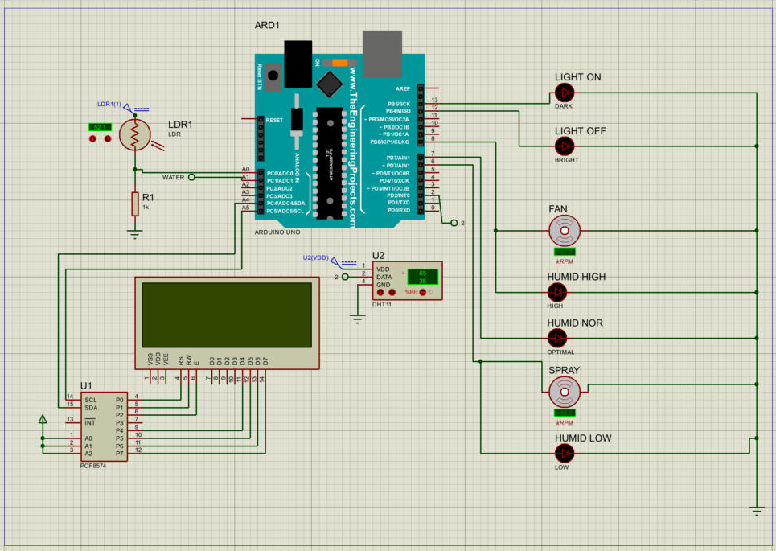
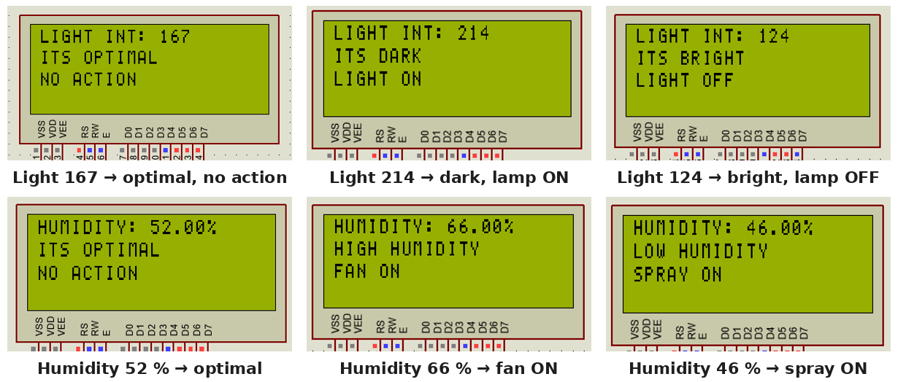
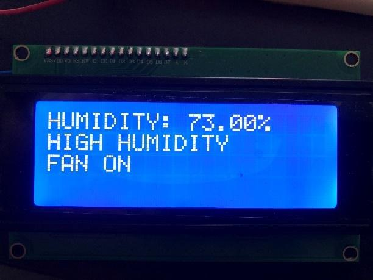
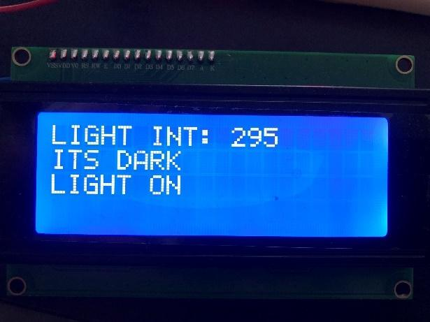
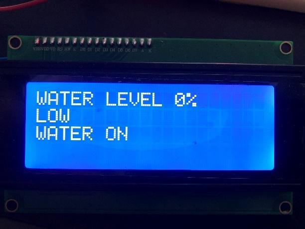
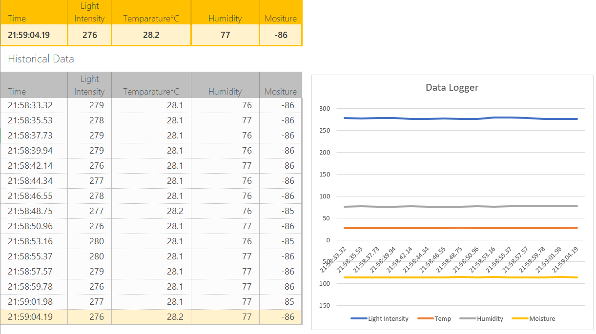

# Automated Plant Growing & Monitoring System

An Arduino Uno system that monitors a plant's light, temperature, humidity, soil moisture and water tank, switches a grow lamp, fan, heat lamp, water spray and watering indicator to keep each value in an optimal range, and shows the readings on a 20x4 I2C LCD. Designed, simulated in Proteus and tested on hardware in 2020.

**Author:** Muhammad Ali Sadiq\*\*
<br>\*\* *Developed as a group course project at Asia Pacific University (APU), Kuala Lumpur, Aug–Sep 2020, together with **Nabeel** (temperature control) and **Shimal** (documentation). See [Credits](#credits).*

**📄 [Paper (PDF)](docs/paper/paper.pdf)**: design, implementation and results &nbsp;·&nbsp; **[Individual report, 2020 (PDF)](docs/report/individual_report_2020.pdf)**



## Motivation

Checking and watering plants by hand takes time and is easy to get wrong. The goal was a microcontroller system that reads the plant's environment, reacts automatically to keep it in the optimal range, and displays every reading and action, so the plant needs less attention and less water is wasted.

## My role

- **Light control:** LDR sensor; grow lamp on when dark, off when bright, no change in between.
- **Humidity control:** DHT11 sensor; spray on when too dry, fan on when too humid.
- **Water-level monitoring** of the spray tank, so the user knows when to refill.
- **Soil-moisture control:** watering indicator on when the soil is dry, off when wet.
- **System integration** and the **Proteus simulation** of the combined system, together with Nabeel.
- Arduino code, LCD interface, hardware test and serial data logging for my subsystems; my individual report.

## Tech stack

| | |
|---|---|
| Microcontroller | Arduino Uno (ATmega328P) |
| Sensors | DHT11 (temperature + humidity), LDR, soil-moisture sensor, water-level sensor; LM35 in the individual temperature prototype |
| Outputs | 20x4 LCD via PCF8574 I2C backpack, LEDs, DC motors (fan / spray / pump) in simulation |
| Language | Arduino C/C++ |
| Tools | Proteus (simulation), Arduino IDE, Excel Data Streamer (logging) |

## Architecture

| Block diagram | Control flow (light and humidity) |
|---|---|
|  |  |

The firmware reads every sensor at the start of each loop, then works through the subsystems one after another. Each one shows its reading on the LCD, sets its indicator outputs and holds the screen for 2 s.

| Input | Condition | Action |
|---|---|---|
| Light (raw ADC, higher = darker) | > 200 | Lamp ON ("ITS DARK") |
| | < 150 | Lamp OFF ("ITS BRIGHT") |
| | 150–200 | No action |
| Humidity (my individual system) | > 60 % | Fan ON |
| | < 50 % | Spray ON |
| Temperature | > 29 °C | Fan ON |
| | 27–29 °C | Normal |
| | otherwise | Heat lamp ON |
| Soil moisture | < 20 % | Watering ON |
| | > 50 % | Watering OFF |
| Water tank | < 20 % | "LOW" (refill needed) |
| | > 80 % | "HIGH" |

### Circuit (Proteus)

My light, humidity and LCD circuit ([`simulation/light_humidity_water_control.pdsprj`](simulation/light_humidity_water_control.pdsprj)):



Pin use: LDR on A0, water level on A1, soil moisture on A3 (integrated system), DHT11 on D2, LCD over I2C on A4/A5 (PCF8574 at 0x27), indicator LEDs and motors on D0–D13.

## Results

**Proteus simulation:** each light and humidity rule was tested by moving the LDR and DHT11 values in the simulation:



**Hardware test:** the system ran on a real Arduino Uno with a DHT11 and a 20x4 I2C LCD:

| High humidity → fan on | Dark → light on | Empty tank → low |
|---|---|---|
|  |  |  |

**Data logging:** readings were streamed over serial into Excel Data Streamer: 15 samples over 31 s, light 276–280, 28.1–28.2 °C, 76–77 % RH.



### Known issues

A 2026 review of the code found these defects. They are left in the code as it was in 2020:

- **Integrated system** ([`plant_monitor_integrated.ino`](code/plant_monitor_integrated/plant_monitor_integrated.ino)):
  - the water level is calculated from the soil sensor's pin (A3) instead of the water sensor (A1);
  - the humidity limits were changed to `> 50` / `< 0`, so the spray can never switch on;
  - the soil mapping `map(raw, 550, 10, 0, 100)` is not clamped (the likely source of the −86 % moisture in the data log) and is then overwritten by a second variable with the same name;
  - exactly 29 °C turns the heat lamp on.
- **Both sketches:**
  - range checks such as `150 > x < 200` are not valid comparisons in C; they only give the right result because they are reached after the other branches;
  - LEDs on pins 0/1 share the Uno's serial lines;
  - a failed DHT reading is displayed as "optimal";
  - `delay(2000)` per screen makes one loop take several seconds.

## How to run

- **Code:** open a sketch from [`code/`](code/) in the Arduino IDE (board: Arduino Uno) and install the *DHT sensor library* (Adafruit) and *LiquidCrystal_I2C*.
  - The sketches use the 2020 version of the LCD library (`lcd.begin()` without arguments). Current versions may need `lcd.init()` instead.
  - [`temperature_control.ino`](code/temperature_control/temperature_control.ino) uses the *NewLiquidCrystal* library.
- **Proteus:** open a project from [`simulation/`](simulation/) and set the Arduino's *Program File* to the matching `.hex` in [`code/`](code/).
  - This needs a licensed copy of Proteus, plus TheEngineeringProjects' Arduino, water-sensor and soil-sensor libraries for Proteus (not included here).
  - The free Proteus demo does not simulate these models.

## Repository structure

```
code/light_humidity_water_control/   my sketch: light, humidity, water level (+ compiled .hex)
code/temperature_control/            Nabeel's sketch: LM35 temperature (+ .hex)
code/plant_monitor_integrated/       combined system: all five subsystems (+ .hex)
simulation/                          Proteus projects with the same names as the sketches
docs/paper/                      paper (PDF + LaTeX source)
docs/report/                     my individual report from 2020
media/                           figures, Proteus screenshots, hardware photos, data log
```

## Status

Complete (2020 course project). Code and simulation files are kept as they were in 2020.

## What I'd improve

- Fix the defects listed above, and replace the blocking `delay()` loop with `millis()` timing so the system reacts continuously.
- Add hysteresis and a dry-run interlock so the watering pump can't run with an empty tank.
- Drive a real pump and lamp through a relay instead of indicator LEDs, and dim the lamp with PWM.
- Use a capacitive soil sensor with a two-point calibration, and add wireless alerts. The GSM refill alert was proposed in the report but not built.

## Credits

- **Muhammad Ali Sadiq:** light, humidity, water-level and soil-moisture subsystems; integration and combined Proteus simulation (with Nabeel); hardware test; individual report.
- **Nabeel:** temperature subsystem ([`code/temperature_control`](code/temperature_control/), [`simulation/temperature_control.pdsprj`](simulation/temperature_control.pdsprj)); integration and combined simulation (with Ali).
- **Shimal:** project documentation.
- Course: Microprocessor Systems & Embedded Software, Asia Pacific University of Technology & Innovation (APU), 2020.
- Proteus component models for the Arduino Uno, water sensor and soil sensor: TheEngineeringProjects.

*No open-source licence: this repository is shared as a portfolio record and includes work by my teammates.*
