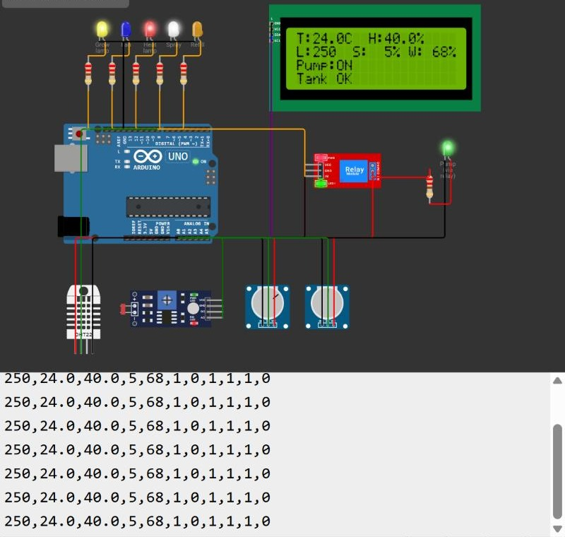
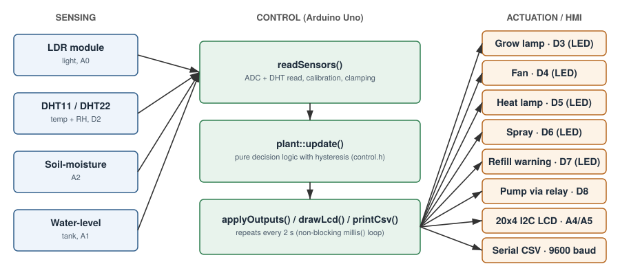
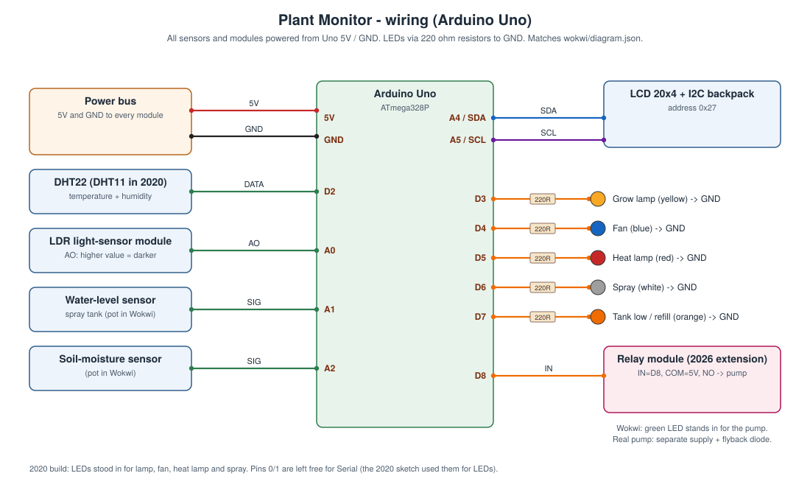

# Automated Plant Growing & Monitoring System

An Arduino Uno system that watches a plant's light, temperature, humidity, soil moisture and water tank, switches a grow lamp, fan, heat lamp, water spray and irrigation pump to keep it in an optimal range, and shows the readings on a 20x4 LCD.

> **Originally developed in 2020 as a university course project; rebuilt in 2026.**
> My original 2020 sketch is kept unchanged in [`original/`](original/). The code in [`src/`](src/) is the 2026 rebuild with the same sensors and thresholds. The relay-driven pump is a 2026 addition, marked as such throughout.

**▶ [Run it in your browser on Wokwi](https://wokwi.com/projects/480434156220494849)** (no hardware or install needed)

**📄 [Read the paper (PDF, 4 pages)](docs/paper/paper.pdf)**: design, implementation and verification.

[](https://wokwi.com/projects/480434156220494849)

## Motivation

Manually checking and watering plants is time-consuming and easy to get wrong. The goal was a microcontroller control system that reads input parameters, drives outputs and displays both, applied to a plant: sense the growing conditions and react automatically, so the plant needs less human attention and less water is wasted.

## What I built

**2026 rebuild:**
- Rewrote the full system (light, temperature, humidity, soil moisture, water level) as a non-blocking Arduino sketch.
- Separated the decision logic into [`control.h`](src/plant_monitor/control.h) so it can be unit-tested on a PC, and wrote the tests.
- Fixed the bugs in the 2020 code (listed in [`original/README.md`](original/README.md)) and added fail-safe handling for sensor errors.
- Added a relay-driven irrigation pump with dry-run protection.
- Built the Wokwi simulation and the wiring diagram.

**2020 version** (Microprocessor Systems & Embedded Software module, B.Eng. Mechatronics, Asia Pacific University, Kuala Lumpur, Aug–Sep 2020):
- **Light control:** LDR light sensor; grow lamp switched on when dark, off when bright, unchanged in between.
- **Humidity control:** DHT11 sensor; water spray on when the air is too dry, fan on when too humid.
- **Water-level monitoring** on the spray's water tank, so the user knows when to refill.
- Interface design, Arduino code, Proteus simulation and hardware test.

## Tech stack

| | |
|---|---|
| Microcontroller | Arduino Uno (ATmega328P) |
| Sensors | DHT11 temperature + humidity (DHT22 in Wokwi), LDR light sensor, soil-moisture sensor, water-level sensor |
| Outputs | 20x4 I2C LCD, LED indicators standing in for lamp / fan / heat lamp / spray, relay module + pump (2026) |
| Language | Arduino C/C++ |
| Tools | Proteus (2020 simulation), Excel Data Streamer (2020 logging), Wokwi (2026 simulation), g++ (host unit tests) |

## Architecture



**Control rules** (thresholds from the 2020 project; inside each "optimal" band the output keeps its last state):

| Input | Condition | Action |
|---|---|---|
| Light (raw ADC, higher = darker) | > 200 | Grow lamp ON |
| | < 150 | Grow lamp OFF |
| Humidity | > 60 % | Fan ON, spray OFF |
| | < 50 % | Spray ON |
| Temperature | > 29 °C | Fan ON |
| | < 27 °C | Heat lamp ON |
| Water tank | < 20 % | Refill warning (clears above 30 %), pump locked out |
| Soil moisture *(2026: drives pump)* | < 20 % | Pump ON |
| | > 50 % | Pump OFF |

The decision logic lives in [`src/plant_monitor/control.h`](src/plant_monitor/control.h) with no Arduino dependencies; the sketch only reads sensors, calls `plant::update()` and writes outputs. The loop is non-blocking (`millis()`), samples every 2 s, prints a CSV line to Serial and rotates the bottom half of the LCD every 3 s.

### Wiring



| Uno pin | Connected to |
|---|---|
| D2 | DHT22 / DHT11 data |
| A0 | LDR module AO |
| A1 | Water-level sensor (potentiometer in Wokwi) |
| A2 | Soil-moisture sensor (potentiometer in Wokwi) |
| A4 / A5 | LCD I2C SDA / SCL (address 0x27) |
| D3 – D7 | LEDs + 220 Ω: grow lamp, fan, heat lamp, spray, refill |
| D8 | Relay module IN (2026), relay switches the pump |

## Results

**2020 hardware prototype:** ran on a real Arduino Uno with a DHT11 and a 20x4 I2C LCD; the actuators were represented by LEDs.

| High humidity → fan | Dark → lamp on | Empty tank |
|---|---|---|
|  |  |  |

**2020 data log** (Serial → Excel Data Streamer, about 30 s at room conditions): light ≈ 277, 28.1 °C, 76–77 % RH. The moisture column reads **-86 %**, which is a bug: the 2020 soil mapping (`map(raw, 550, 10, 0, 100)`) was not clamped, so an out-of-range reading went negative. The 2026 version clamps it.


**2026 Wokwi simulation:** the rebuilt sketch compiles and runs in Wokwi. With the default sensor values (24 °C, 40 % RH, dark, soil dry, tank 68 %) it turns on the grow lamp, heat lamp, spray and, through the relay, the pump (screenshot at the top). With an empty tank the refill warning comes on and the pump stays locked out. Both test cases are in Table 3 of the [paper](docs/paper/paper.pdf).

**Unit tests:** `tests/test_control.cpp` checks every threshold, the hold-in-band behaviour, fail-safe on DHT read errors, the pump lockout and the clamping that fixes the -86 % bug.

What could **not** be reproduced: no real pump, fan or lamp was ever driven (2020 or 2026), and the soil and water sensors in Wokwi are potentiometers, so the calibration values are from the 2020 code, not new measurements.

## How to run

### Run it in the Wokwi simulator (no hardware)

**In the browser:** open the saved project at <https://wokwi.com/projects/480434156220494849> and press ▶.

To rebuild it from this repo instead:
1. Open <https://wokwi.com/projects/new/arduino-uno>.
2. Replace `sketch.ino` with [`src/plant_monitor/plant_monitor.ino`](src/plant_monitor/plant_monitor.ino).
3. Add a new file `control.h` with the contents of [`src/plant_monitor/control.h`](src/plant_monitor/control.h).
4. Replace `diagram.json` with [`wokwi/diagram.json`](wokwi/diagram.json).
5. In **Library Manager** add `DHT sensor library` and `LiquidCrystal I2C` (or add a `libraries.txt` with [these lines](wokwi/libraries.txt)).
6. Press ▶. Click the DHT22, the LDR module or the two potentiometers while it runs to change the readings.

**In VS Code** (Wokwi extension + [arduino-cli](https://arduino.github.io/arduino-cli/)):
```bash
arduino-cli core install arduino:avr
arduino-cli lib install "DHT sensor library" "Adafruit Unified Sensor" "LiquidCrystal I2C"
arduino-cli compile --fqbn arduino:avr:uno --output-dir build src/plant_monitor
```
Then open `wokwi/wokwi.toml` and run **Wokwi: Start Simulator**.

### On real hardware
Wire it as in the table above, change `#define DHT_TYPE DHT22` to `DHT11` if that is your sensor, recalibrate `SOIL_RAW_DRY` / `SOIL_RAW_WET` for your probe and upload with the Arduino IDE. Open the Serial Monitor at 9600 baud for the CSV log. A real pump needs its own supply on the relay contacts, not the Uno's 5 V.

### Unit tests (any PC with g++)
```bash
cd tests
g++ -std=c++11 -Wall -I../src/plant_monitor test_control.cpp -o test_control && ./test_control
```

## Repository structure

```
src/plant_monitor/   refactored sketch + control.h (decision logic)
tests/               host-side unit tests for control.h
wokwi/               diagram.json, libraries.txt, wokwi.toml
docs/                paper (PDF + LaTeX source), architecture and wiring diagrams
media/               2020 prototype photos and data log, 2026 simulation screenshot
original/            my 2020 sketch (light, humidity, water level), unchanged
```

## Status

Complete as a portfolio piece. The 2020 hardware no longer exists; the 2026 version is verified in simulation and by unit tests only.

## What I'd improve

- Replace the bang-bang lamp with PWM dimming (the 2020 design called for a *dimmable* lamp but only switched it).
- Capacitive soil sensor instead of a resistive one (resistive probes corrode), with a proper two-point calibration routine.
- Log to an SD card or send data over Wi-Fi (ESP32) instead of a PC-tethered serial log; the 2020 report proposed a GSM SMS alert for low water, which was never built.
- Run the pump for a timed pulse and wait for the water to soak in, instead of watering until the sensor reads "wet".

## Credits

- Author: Muhammad Ali Sadiq
- Libraries: [Adafruit DHT sensor library](https://github.com/adafruit/DHT-sensor-library), [LiquidCrystal I2C](https://github.com/johnrickman/LiquidCrystal_I2C).

Licensed under the [MIT License](LICENSE).
